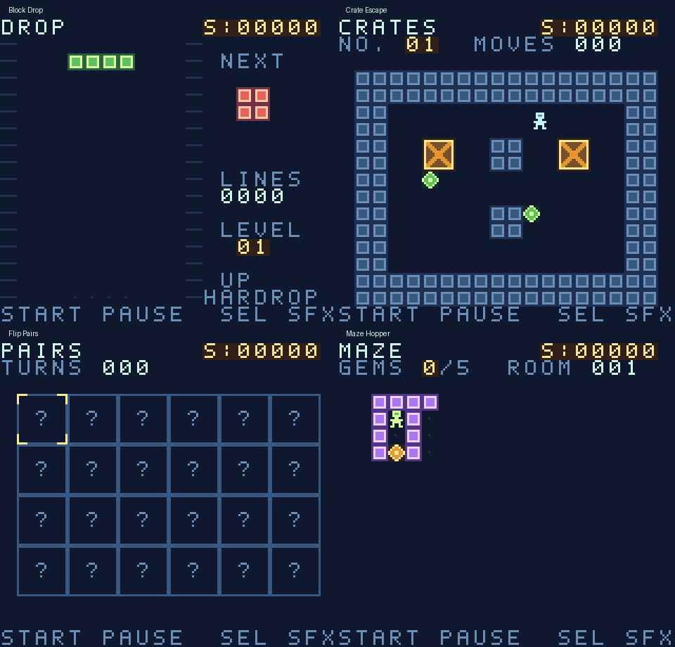

# Flight Arcade

Sixteen original games in one offline Game Boy Color ROM, built for cartridge play on the ModRetro Chromatic. Includes 24 crate puzzles, 20 peg puzzles, generated mazes and light puzzles, saved best scores, pause, and a sound toggle.

[Download the ROM and source](https://github.com/dmfenton/flight-arcade/releases/latest) · [MIT License](LICENSE)



| Game | Play | Controls |
| --- | --- | --- |
| Star Skimmer | Dodge enemy ships and fire in a space shooter. | D-pad moves; hold A to fire. |
| Orchard Snake | Collect fruit and grow without hitting walls or your tail. | D-pad turns; hold A for turbo. |
| Brick Flight | Clear successive walls of bricks with three balls. | Left/right moves the paddle; A launches. Paddle contact changes the bounce angle. |
| Merge Cabin | Merge matching tiles toward 2048 and beyond. | D-pad slides; B undoes the last successful move. |
| Mine Garden | Clear 53 safe cells around 10 hidden mines. The first pick and its neighbors are safe. | D-pad moves the cursor; A reveals; B flags or unflags. |
| Lights Out | Solve an endless sequence of solvable 5-by-5 light puzzles. | D-pad moves; A flips a light and its neighbors; B undoes one flip. A advances after solving. |
| Orbit Rally | Beat the opposing paddle in a first-to-seven match. | Up/down moves; A serves. |
| River Run | Steer through a winding river, avoid rocks, and collect gems. | Left/right steers; hold A to boost. |
| Block Drop | Clear rows of falling blocks with a seven-piece bag and landing preview. | Left/right moves; A/B rotates clockwise/counterclockwise; down soft-drops; up hard-drops. |
| Crate Escape | Push crates onto targets in 24 solvable puzzles. | D-pad walks/pushes; A undoes one move; B restarts. Left/right chooses a puzzle before play. |
| Flip Pairs | Find 12 matching pairs in a 24-card memory game. | D-pad moves; A flips; B cancels the first pick. |
| Maze Hopper | Explore a fresh maze, collect five gems, and reach the gate. | D-pad walks; hold A to see the whole map. |
| Peg Trails | Jump pegs to leave one in 20 solvable puzzles. | D-pad moves; A selects a peg, then its landing hole; B cancels or undoes. Left/right chooses a puzzle before play. |
| Orbit Discs | A six-by-six Reversi match against the CPU. Trap red discs between green discs to flip them. | D-pad moves; A places; B toggles legal-move hints. Turns pass automatically when necessary. |
| Golf Solitaire | Clear seven five-card stacks onto the waste using adjacent ranks. Suits do not matter; Ace/King wraps. | Left/right selects a stack; A plays its bottom card; B draws. T means ten. Random deals are not guaranteed solvable. |
| Lunar Lander | Land softly inside the illuminated pad, then try a new mission. | Left/right applies sideways thrust; A or up fires the main thruster. Watch fuel and approach slowly. |

The arcade menu has two pages. **Up/down** selects a game; **left/right** changes pages; **A or Start** opens its instructions. All 44 crate and peg puzzles are available immediately.

Press **Start** to pause. In the pause screen, **A or Start** resumes and **B** returns to the arcade menu. **Select** toggles sound during play. In the arcade menu, **B** toggles sound. There is no background music.

Best scores and the sound setting persist in cartridge FRAM. An unfinished round does not resume after turning off the console. Return to the menu or finish the round to record its best score before powering off.

## Play

Open [build/FlightArcade.gbc](build/FlightArcade.gbc) in a Game Boy Color emulator, or download the ROM from [Releases](https://github.com/dmfenton/flight-arcade/releases/latest). The 512 KiB ROM uses MBC5 with 32 KiB battery-backed save RAM and requires Game Boy Color support. Original monochrome Game Boy hardware is not supported.

For a writable Chromatic cartridge, use the official updater's activated **Homebrew** option or the official `@modretro/chromatic-cli` package. Follow [ModRetro's developer setup guide](https://support.modretro.com/en_us/chromatic-devday-edition-quickstart-guid-By1iOlcMg) for supported hardware and developer activation. Back up any existing cartridge save before writing; a save backup does not back up the original game ROM. Writing this compilation replaces the cartridge's existing game.

With a powered-on, connected Chromatic and its writable cartridge inserted, the official CLI commands are:

```sh
chromatic-cli write-homebrew ./build/FlightArcade.gbc --player 1 --expect-sha256 <SHA256-FROM-MANIFEST> --yes
chromatic-cli reset-device --player 1 --yes
```

Read the expected hash from `verification/rom-manifest.json`. Keep the console powered on and connected throughout the write. Confirm the arcade menu, physical controls, and sound afterward. The updater, CLI, developer activation codes, and cartridge backups are not distributed with this project.

The release build was written successfully to a 4 MiB DevDay cartridge, its header was read back and checked, and the handheld reset succeeded. The owner confirmed the game looks good on the physical Chromatic. Physical controls and audio have not been separately confirmed; emulator checks are reported below.

## Architecture map

| Responsibility | Owner |
| --- | --- |
| Menu, game selection, game dispatch | `src/main.c` |
| Game names, short descriptions, instructions and game count | `src/games.json`; `src/generate_catalog.py` generates `catalog.h`, `catalog.c`, and `instructions.c` |
| Joypad transitions, pause/resume, score recording, sound effects, FRAM persistence | `src/core.c` |
| Tile and sprite rendering, palettes, disposable display cache | `src/core.c` |
| Active round state and rules | The corresponding game source file (`star`, `snake`, `bricks`, `merge`, `mines`, `lights`, `rally`, `river`, `drop`, `crates`, `pairs`, `maze`, `pegs`, `discs`, `golf`, `lander`) |
| Open puzzle picker | `src/puzzles.c` |
| Original crate/peg puzzle generation and solution checks | `src/generate_puzzles.py`; `puzzle_data.c`, `peg_data.c`, and `verification/puzzle-solutions.json` are generated |
| Original fonts and artwork | `src/generate_assets.py`; `src/assets.c` is generated |
| Shared hardware constants and interfaces | `src/arcade.h` |
| Compilation and ROM header | `build.sh` with GBDK 2020 4.5.0, from `GBDK_ROOT` or `tools/gbdk` |
| Emulator inputs, screenshots, result checks and progress traces | `verify.py`, `playtest.py`, `playtest_more.py`, `verify_navigation.py`, `verification/`, `private/` |

Game code occupies separate MBC5 ROM banks. The menu and shared routines live in bank zero; instructions and the puzzle picker share bank 17. There are no network calls, accounts, subscriptions, or runtime dependencies outside the cartridge. FRAM owns persistent best scores and the sound setting; their in-memory values are loaded at boot and written when changed. The 16-game save layout is version 2. Active round state remains in working RAM. Rendering copies are disposable caches of that state.

## Build and verify

Building requires Python 3 and [GBDK 2020 4.5.0](https://github.com/gbdk-2020/gbdk-2020/releases/tag/4.5.0). Use the SDK archive for your OS and CPU. Extract its `gbdk` directory into `tools/` so that `tools/gbdk/bin/lcc` exists, or point `GBDK_ROOT` at an existing installation. The build script runs in a POSIX shell on macOS or Linux.

From the repository root:

```sh
sh ./build.sh
# Or: GBDK_ROOT=/absolute/path/to/gbdk sh ./build.sh
```

The output is `build/FlightArcade.gbc`. Generated artwork, catalog, instructions, and puzzle data are refreshed from their Python/JSON sources during the build. The SDK is downloaded separately and is not included in the repository or release archive.

For the automated emulator checks, use Python 3.12 or newer and the pinned development dependencies. A reusable environment can be shared across checkouts:

```sh
python3 -m venv ~/.venvs/flight-arcade
. ~/.venvs/flight-arcade/bin/activate
python -m pip install -r requirements-dev.txt
python verify.py
python playtest.py
python playtest_more.py
python verify_navigation.py
python package.py
```

`package.py` verifies the ROM header, checksums, sound/mute results, and that all test summaries match the current ROM hash. It writes `verification/rom-manifest.json` and `FlightArcade.zip`, containing the ROM, source, license, guide, and public verification summaries. Cartridge backups, device reports, traces, SDK downloads, and flashing tools are excluded. CI runs the same build and playtests on Linux and retains the tested artifacts.

The smoke suite boots the real compiled ROM and uses joypad input to enter every game, display instructions, pause, resume, and return to the menu. Extended tests play the shooter, collect snake fruit, clear the first brick wall, verify merge conservation and undo, clear a mine board, solve ten generated light puzzles, win a rally match, and navigate the narrowing river. Added-game tests clear falling-block rows, solve all 44 crate/peg puzzles, match all cards, escape a maze, finish a legal Reversi match, clear a normally dealt solitaire game, and make two soft landings. Save persistence is checked by exporting cartridge RAM and booting a new emulator with it, including scores for the added games. Test bots read game memory and rendered sprites to choose inputs; they do not write game state. These are functional checks, not a claim that an automated bot evaluated subjective fun.

The river pilot and solitaire solver may try multiple normally generated games. Attempts vary only menu timing through normal emulation; they never edit ROM or RAM to force a win. Results record those attempts. Generated puzzle solutions are replayed through the joypad to verify the actual cartridge program. Audio checks confirm sound output and a silent muted mode in the emulator.

The navigation audit enters every game through real joypad input and checks instruction-screen back, held-button behavior, pause/resume with A and Start, sound toggling while paused, and return to the same menu selection. It checks puzzle-picker cancellation and wrap, full merge-board undo/finish, mine-loss continuation, solved-light progression, and both replay and direct-menu routes from every game's result screen. Result screens are reached through normal gameplay, not injected state. **Start, then B** returns from gameplay to the arcade menu; **B** backs out of instructions, puzzle pickers, and result screens.

Screenshots and public test summaries are in `verification/`. Detailed input traces and atomically updated progress stay in the main checkout's owner-readable `private/` directory, resolved through Git's common directory. An extracted source archive uses its own `private/` folder. Device-specific reports and cartridge backups are ignored by Git and excluded from releases.

## License and contributions

Project code, tile/font artwork, sound effects, puzzle definitions, generators, tests, and documentation are released under the [MIT License](LICENSE). See [third-party notices](THIRD_PARTY_NOTICES.md) for GBDK, SDCC, development tools, and hardware trademarks. Contributions are welcome; see [CONTRIBUTING.md](CONTRIBUTING.md).
